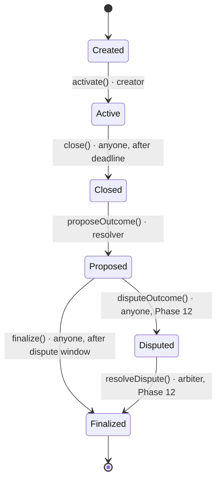

# Market State Machine

Authoritative lifecycle for every `PredictionMarket`. Implemented in Phase 5; the dispute edges
land in Phase 12 (ADR 0006).

## States

| State       | Meaning                                                                  |
| ----------- | ------------------------------------------------------------------------ |
| `Created`   | Market exists; liquidity not seeded, trading not open.                   |
| `Active`    | Trading is open (Phase 6+); closes at `deadline`.                        |
| `Closed`    | Deadline passed; trading is over; awaiting an outcome.                   |
| `Proposed`  | Resolver proposed `Yes`/`No`; dispute window is running.                 |
| `Disputed`  | A bonded challenge is open; arbiter decides (Phase 12).                  |
| `Finalized` | Outcome is final; winners can redeem (Phase 6+). No further transitions. |

## Transitions

| #   | From       | Action             | Caller        | Guard                                            | To          | Event             | Phase |
| --- | ---------- | ------------------ | ------------- | ------------------------------------------------ | ----------- | ----------------- | ----- |
| 1   | `Created`  | `activate()`       | creator       | `status == Created`                              | `Active`    | `MarketActivated` | 5     |
| 2   | `Active`   | `close()`          | anyone        | `block.timestamp >= deadline`                    | `Closed`    | `MarketClosed`    | 5     |
| 3   | `Closed`   | `proposeOutcome()` | resolver      | outcome is `Yes` or `No`                         | `Proposed`  | `OutcomeProposed` | 5     |
| 4   | `Proposed` | `disputeOutcome()` | anyone + bond | inside dispute window                            | `Disputed`  | `OutcomeDisputed` | 12    |
| 5   | `Proposed` | `finalize()`       | anyone        | `block.timestamp >= proposedAt + window + delay` | `Finalized` | `MarketFinalized` | 5     |
| 6   | `Disputed` | `resolveDispute()` | arbiter       | arbiter ruling                                   | `Finalized` | `MarketFinalized` | 12    |

`DISPUTE_WINDOW = 2 hours` and `FINALIZATION_DELAY = 0` on testnet. The window is wall-clock based;
validator timestamp drift of a few seconds is accepted.

## State × action matrix

`A` = allowed, `R` = reverts (`InvalidState`). Implemented and exhaustively tested in
`test/PredictionMarket.t.sol::test_StateActionMatrix`.

| State       | `activate` | `close` | `proposeOutcome` | `finalize` |
| ----------- | :--------: | :-----: | :--------------: | :--------: |
| `Created`   |     A      |    R    |        R         |     R      |
| `Active`    |     R      |    A    |        R         |     R      |
| `Closed`    |     R      |    R    |        A         |     R      |
| `Proposed`  |     R      |    R    |        R         |     A      |
| `Disputed`  |     R      |    R    |        R         |     R      |
| `Finalized` |     R      |    R    |        R         |     R      |

`Disputed` is defined in the enum but unreachable until Phase 12, so its row is all `R` today.

## Invariants

- No action can skip a state; every transition checks the current state (`onlyState`).
- `close()` is permissionless but only after `deadline`; it cannot run before trading opens.
- Only `resolver` may propose, and only after the market is `Closed`.
- Only `Yes`/`No` can be proposed; `Unresolved` is rejected.
- `proposedOutcome` never changes after a proposal.
- `finalize()` is permissionless but only after the dispute window; no payout (Phase 6+) is possible
  before `Finalized`.

## Notes

- **`activate()` is temporary.** Phase 7 replaces it with `seedLiquidity()`, which activates the
  market only after collateral is deposited. Until then, the creator can activate directly.
- **"Resolved" is not a separate state.** The roadmap's `Resolved` maps to `Proposed` (outcome
  known) and `Finalized` (payout enabled), per the authoritative ADR 0006 diagram.
- **Disputes** (`Disputed`) and arbiter finalization are Phase 12; see ADR 0006.

## Related

- `PROJECT_PLAN.md` §7.3
- `docs/adr/0005-oracle-resolution.md`, `docs/adr/0006-dispute-and-trust.md`
- `packages/contracts/src/PredictionMarket.sol`
