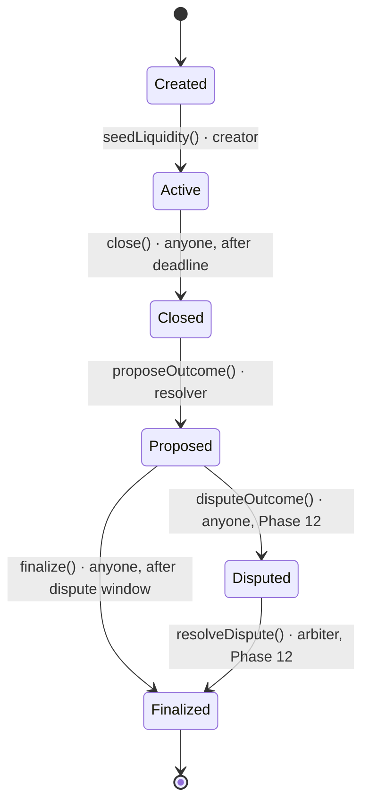

# Market State Machine

Authoritative lifecycle for every `PredictionMarket`. Implemented through Phase 11; the dispute
edges land in Phase 12 (ADR 0006).

## States

| State       | Meaning                                                                              |
| ----------- | ------------------------------------------------------------------------------------ |
| `Created`   | Market exists; liquidity not seeded, trading not open.                               |
| `Active`    | AMM seeded; trading, split, merge, and LP add/remove are open. Closes at `deadline`. |
| `Closed`    | Deadline passed; trading is over; awaiting an outcome.                               |
| `Proposed`  | Resolver proposed `Yes`/`No`; dispute window is running.                             |
| `Disputed`  | A bonded challenge is open; arbiter decides (Phase 12).                              |
| `Finalized` | Outcome is final; winners can redeem and LPs can settle. No further transitions.     |

## Transitions

| #   | From       | Action             | Caller        | Guard                                            | To          | Event                                                  | Phase |
| --- | ---------- | ------------------ | ------------- | ------------------------------------------------ | ----------- | ------------------------------------------------------ | ----- |
| 1   | `Created`  | `seedLiquidity()`  | creator       | `status == Created`                              | `Active`    | `LiquiditySeeded`, `LiquidityAdded`, `MarketActivated` | 7/9   |
| 2   | `Active`   | `close()`          | anyone        | `block.timestamp >= deadline`                    | `Closed`    | `MarketClosed`                                         | 5     |
| 3   | `Closed`   | `proposeOutcome()` | resolver      | outcome is `Yes` or `No`                         | `Proposed`  | `OutcomeProposed`                                      | 5     |
| 4   | `Proposed` | `disputeOutcome()` | anyone + bond | inside dispute window                            | `Disputed`  | `OutcomeDisputed`                                      | 12    |
| 5   | `Proposed` | `finalize()`       | anyone        | `block.timestamp >= proposedAt + window + delay` | `Finalized` | `MarketFinalized`                                      | 5     |
| 6   | `Disputed` | `resolveDispute()` | arbiter       | arbiter ruling                                   | `Finalized` | `MarketFinalized`                                      | 12    |

`DISPUTE_WINDOW = 2 hours` and `FINALIZATION_DELAY = 0` on testnet. The window is wall-clock based;
validator timestamp drift of a few seconds is accepted.

## State × action matrix

`A` = allowed, `R` = reverts (`InvalidState`). Implemented and exhaustively tested in
`test/PredictionMarket.t.sol::test_StateActionMatrix`.

| State       | `seedLiquidity` | `close` | `proposeOutcome` | `finalize` |
| ----------- | :-------------: | :-----: | :--------------: | :--------: |
| `Created`   |        A        |    R    |        R         |     R      |
| `Active`    |        R        |    A    |        R         |     R      |
| `Closed`    |        R        |    R    |        A         |     R      |
| `Proposed`  |        R        |    R    |        R         |     A      |
| `Disputed`  |        R        |    R    |        R         |     R      |
| `Finalized` |        R        |    R    |        R         |     R      |

`Disputed` is defined in the enum but unreachable until Phase 12, so its row is all `R` today.

## Non-transition actions

These do not change `status`; they move collateral and outcome tokens.

| Action                                                | Allowed states                         | Caller | Effect                                                                                                        | Phase |
| ----------------------------------------------------- | -------------------------------------- | ------ | ------------------------------------------------------------------------------------------------------------- | ----- |
| `split()`                                             | `Active`                               | anyone | Pull `amount` USDC → mint `amount` YES + `amount` NO                                                          | 6     |
| `merge()`                                             | `Active` → `Finalized` (not `Created`) | anyone | Burn `amount` YES + `amount` NO → return `amount` USDC                                                        | 6     |
| `buy(outcome, collateralIn, minSharesOut, deadline)`  | `Active`                               | anyone | Split USDC, swap the opposite leg, enforce slippage/deadline, send `outcome` tokens; protocol fee to treasury | 8     |
| `sell(outcome, sharesIn, minCollateralOut, deadline)` | `Active`                               | anyone | Swap `outcome` for the opposite leg, merge, enforce slippage/deadline, send USDC; protocol fee to treasury    | 8     |
| `addLiquidity(usdcAmount)`                            | `Active`                               | anyone | Split USDC, add both legs, mint LP shares                                                                     | 9     |
| `removeLiquidity(lpAmount)`                           | `Active`                               | anyone | Burn LP, return proportional YES/NO reserves                                                                  | 9     |
| `quoteBuy()`                                          | `Active` (view)                        | anyone | Quote `sharesOut` + `fee`; no state change                                                                    | 7/8   |
| `quoteSell()`                                         | `Active` (view)                        | anyone | Quote `collateralOut` + `fee`; no state change                                                                | 7/8   |
| `getReserves()`                                       | any (view)                             | anyone | Returns `(reserveYes, reserveNo)`                                                                             | 7     |
| `lpToken()`                                           | any (view)                             | anyone | Returns the market's LP token address                                                                         | 9     |
| `priceYes()`                                          | any (view)                             | anyone | Implied YES probability in WAD (reverts if pool is empty)                                                     | 7     |
| `redeem()` / `redeem(uint256)`                        | `Finalized`                            | holder | Burn winning shares, pay 1 USDC/share; losing shares are worthless                                            | 10    |
| `redeemLiquidity(uint256)`                            | `Finalized`                            | LP     | Burn LP, pay the winning reserve share in USDC                                                                | 10    |
| `claimed(address)`                                    | any (view)                             | anyone | Cumulative winning shares redeemed by an account                                                              | 10    |

## Invariants

- No action can skip a state; every transition checks the current state (`onlyState`).
- `close()` is permissionless but only after `deadline`; it cannot run before trading opens.
- Only `resolver` may propose, and only after the market is `Closed`.
- Only `Yes`/`No` can be proposed; `Unresolved` is rejected.
- `proposedOutcome` never changes after a proposal.
- `finalize()` is permissionless but only after the dispute window; no payout (Phase 10) is possible
  before `Finalized`.
- Before finalization, `totalSupply(YES) == totalSupply(NO)` and
  `collateral.balanceOf(market) >= totalSupply(YES)` after every split/merge/buy/sell. After
  finalization, `collateral.balanceOf(market) >= winningSupply` (`isFullyBacked()`), enforced by
  construction and covered by stateful invariant tests.
- The CPMM invariant `reserveYes · reserveNo >= k₀` holds after every buy/sell while LP supply is
  unchanged; fees accrue to the pool (see `docs/amm.md`).
- Market YES/NO balances always equal the tracked reserves; `0 < priceYes < 1e18` while the pool is
  non-empty.
- LP supply is zero iff both reserves are zero after a full exit; LP redemption is proportional and
  never exceeds reserves; outstanding positions stay fully backed when LPs exit.
- After finalization, user redemptions and LP settlements can occur in any order; total payouts can
  never exceed the collateral held at finalization.

## Notes

- **`seedLiquidity()` replaces the Phase 5 `activate()`.** It pulls the creator's
  `initialLiquidity`, splits it into a complete set, deposits both legs 50/50, and only then moves
  `Created → Active`. A market cannot trade before it is seeded.
- **Trading is Active-only.** `buy()`/`sell()` revert with `InvalidState` after `close()`; quotes are
  views and remain callable, but they do not move funds.
- **Fees are split in Phase 8.** The AMM takes the output fee; 20% of it is sent to `treasury` in
  the fee outcome token and the remaining 80% stays in the pool for LPs. `buy`/`sell` enforce
  slippage/deadline bounds, are `nonReentrant`, and emit `Trade` + `ProtocolFee`.
- **LPs hold ERC-20 shares in Phase 9.** `seedLiquidity` mints LP to the creator; `addLiquidity` and
  `removeLiquidity` are `Active`-only and mint/burn at proportional reserve ratios. Removing
  liquidity returns YES/NO, which can be merged into USDC.
- **"Resolved" is not a separate state.** The roadmap's `Resolved` maps to `Proposed` (outcome
  known) and `Finalized` (payout enabled), per the authoritative ADR 0006 diagram.
- **Disputes** (`Disputed`) and arbiter finalization are Phase 12; see ADR 0006.
- **`split()` is Active-only** so no complete sets can be created after trading stops; `merge()`
  stays open through `Finalized` so holders can always recover a complete set's collateral.
- **Settlement is Phase 10.** `redeem()` burns winning shares for 1 USDC each; losing shares pay
  zero. `redeemLiquidity()` burns LP and pays the winning reserve share. The winning token burn is
  the double-claim guard, and `claimed` is an analytics counter.
- **Resolution is Phase 11.** `OracleResolver` wraps a Chainlink `AggregatorV3Interface` feed and
  `ManualResolver` is the owner-controlled fallback. Both close an `Active` market at/after its
  deadline, validate the state, and call `proposeOutcome`; the dispute window still applies.

## Related

- `PROJECT_PLAN.md` §7.3
- `docs/adr/0003-token-model.md`, `docs/adr/0004-pricing-amm.md`
- `docs/adr/0005-oracle-resolution.md`, `docs/adr/0006-dispute-and-trust.md`
- `docs/amm.md`, `docs/resolution.md`
- `packages/contracts/src/PredictionMarket.sol`
