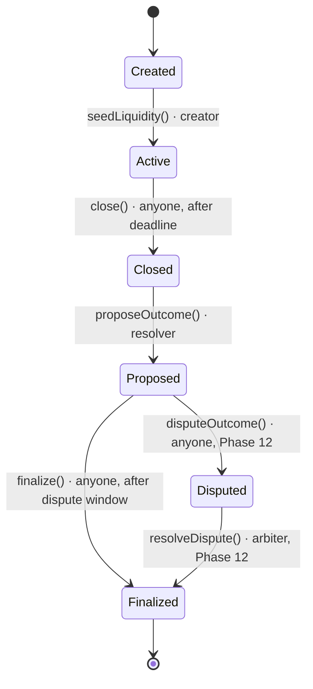

# Market State Machine

Authoritative lifecycle for every `PredictionMarket`. Implemented in Phase 5; the dispute edges
land in Phase 12 (ADR 0006).

## States

| State       | Meaning                                                                  |
| ----------- | ------------------------------------------------------------------------ |
| `Created`   | Market exists; liquidity not seeded, trading not open.                   |
| `Active`    | AMM seeded; trading, split, and merge are open. Closes at `deadline`.    |
| `Closed`    | Deadline passed; trading is over; awaiting an outcome.                   |
| `Proposed`  | Resolver proposed `Yes`/`No`; dispute window is running.                 |
| `Disputed`  | A bonded challenge is open; arbiter decides (Phase 12).                  |
| `Finalized` | Outcome is final; winners can redeem (Phase 10). No further transitions. |

## Transitions

| #   | From       | Action             | Caller        | Guard                                            | To          | Event                                | Phase |
| --- | ---------- | ------------------ | ------------- | ------------------------------------------------ | ----------- | ------------------------------------ | ----- |
| 1   | `Created`  | `seedLiquidity()`  | creator       | `status == Created`                              | `Active`    | `LiquiditySeeded`, `MarketActivated` | 7     |
| 2   | `Active`   | `close()`          | anyone        | `block.timestamp >= deadline`                    | `Closed`    | `MarketClosed`                       | 5     |
| 3   | `Closed`   | `proposeOutcome()` | resolver      | outcome is `Yes` or `No`                         | `Proposed`  | `OutcomeProposed`                    | 5     |
| 4   | `Proposed` | `disputeOutcome()` | anyone + bond | inside dispute window                            | `Disputed`  | `OutcomeDisputed`                    | 12    |
| 5   | `Proposed` | `finalize()`       | anyone        | `block.timestamp >= proposedAt + window + delay` | `Finalized` | `MarketFinalized`                    | 5     |
| 6   | `Disputed` | `resolveDispute()` | arbiter       | arbiter ruling                                   | `Finalized` | `MarketFinalized`                    | 12    |

`DISPUTE_WINDOW = 2 hours` and `FINALIZATION_DELAY = 0` on testnet. The window is wall-clock based;
validator timestamp drift of a few seconds is accepted.

## State × action matrix

`A` = allowed, `R` = reverts (`InvalidState`). Implemented and exhaustively tested in
`test/PredictionMarket.t.sol::test_StateActionMatrix`.

| State       | `seedLiquidity` | `close` | `proposeOutcome` | `finalize` |
| ----------- | :-------------: | :-----: | :--------------: | :--------: |
| `Created`   |        A        |    R    |        R         |     R      |
| `Active`    |        R        |    A    |        R         |     R      |
| `Closed`    |        R        |    R    |        A         |     R      |
| `Proposed`  |        R        |    R    |        R         |     A      |
| `Disputed`  |        R        |    R    |        R         |     R      |
| `Finalized` |        R        |    R    |        R         |     R      |

`Disputed` is defined in the enum but unreachable until Phase 12, so its row is all `R` today.

## Non-transition actions

These do not change `status`; they move collateral and outcome tokens.

| Action                  | Allowed states                         | Caller | Effect                                                    | Phase |
| ----------------------- | -------------------------------------- | ------ | --------------------------------------------------------- | ----- |
| `split()`               | `Active`                               | anyone | Pull `amount` USDC → mint `amount` YES + `amount` NO      | 6     |
| `merge()`               | `Active` → `Finalized` (not `Created`) | anyone | Burn `amount` YES + `amount` NO → return `amount` USDC    | 6     |
| `buy(outcome, usdc)`    | `Active`                               | anyone | Split USDC, swap the opposite leg, send `outcome` tokens  | 7     |
| `sell(outcome, shares)` | `Active`                               | anyone | Swap `outcome` for the opposite leg, merge, send USDC     | 7     |
| `quoteBuy()`            | `Active` (view)                        | anyone | Quote `sharesOut` + `fee`; no state change                | 7     |
| `quoteSell()`           | `Active` (view)                        | anyone | Quote `collateralOut` + `fee`; no state change            | 7     |
| `getReserves()`         | any (view)                             | anyone | Returns `(reserveYes, reserveNo)`                         | 7     |
| `priceYes()`            | any (view)                             | anyone | Implied YES probability in WAD (reverts if pool is empty) | 7     |
| `redeem()`              | `Finalized`                            | holder | Stub: reverts `RedeemNotImplemented` until Phase 10       | 6/10  |

## Invariants

- No action can skip a state; every transition checks the current state (`onlyState`).
- `close()` is permissionless but only after `deadline`; it cannot run before trading opens.
- Only `resolver` may propose, and only after the market is `Closed`.
- Only `Yes`/`No` can be proposed; `Unresolved` is rejected.
- `proposedOutcome` never changes after a proposal.
- `finalize()` is permissionless but only after the dispute window; no payout (Phase 10) is possible
  before `Finalized`.
- `totalSupply(YES) == totalSupply(NO)` and
  `collateral.balanceOf(market) >= totalSupply(YES)` after every split/merge/buy/sell
  (`isFullyBacked()`), enforced by construction and covered by stateful invariant tests.
- The CPMM invariant `reserveYes · reserveNo >= k₀` holds after every buy/sell; fees accrue to the
  pool (see `docs/amm.md`).
- Market YES/NO balances always equal the tracked reserves; `0 < priceYes < 1e18` while the pool is
  non-empty.

## Notes

- **`seedLiquidity()` replaces the Phase 5 `activate()`.** It pulls the creator's
  `initialLiquidity`, splits it into a complete set, deposits both legs 50/50, and only then moves
  `Created → Active`. A market cannot trade before it is seeded.
- **Trading is Active-only.** `buy()`/`sell()` revert with `InvalidState` after `close()`; quotes are
  views and remain callable, but they do not move funds.
- **Fees stay in the pool in Phase 7.** `buy`/`sell` do not yet take slippage/deadline parameters or
  route LP/protocol shares; Phase 8 adds those plus the canonical `Trade` event.
- **"Resolved" is not a separate state.** The roadmap's `Resolved` maps to `Proposed` (outcome
  known) and `Finalized` (payout enabled), per the authoritative ADR 0006 diagram.
- **Disputes** (`Disputed`) and arbiter finalization are Phase 12; see ADR 0006.
- **`split()` is Active-only** so no complete sets can be created after trading stops; `merge()`
  stays open through `Finalized` so holders can always recover a complete set's collateral.
- **`redeem()` is a stub** in Phase 6 and always reverts; Phase 10 implements the payout.

## Related

- `PROJECT_PLAN.md` §7.3
- `docs/adr/0003-token-model.md`, `docs/adr/0004-pricing-amm.md`
- `docs/adr/0005-oracle-resolution.md`, `docs/adr/0006-dispute-and-trust.md`
- `docs/amm.md`
- `packages/contracts/src/PredictionMarket.sol`
